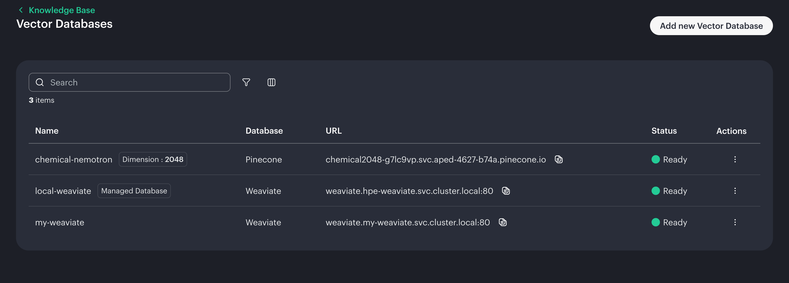
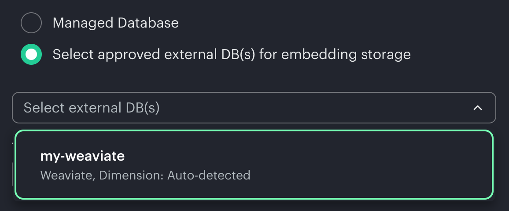

[日本語](./README_JP.md)

# Knowledge Base with imported Weaviate
**Verified with version 202607**

This article explains how to use an imported Weaviate instead of the shared Weaviate in Knowledge Base.

## Procedure

### Importing Weaviate
You can use the Import Framework to import Weaviate using a Helm chart available in [HPE's GitHub repository](https://github.com/ai-solution-eng/frameworks).

### Making k8s custom resource
HPE AI Essentials gives us a CRD for the vectorstores.

```
$ kubectl explain --recursive vectorstores.genai.hpe.com
GROUP:      genai.hpe.com
KIND:       VectorStore
VERSION:    v1alpha1

DESCRIPTION:
    VectorStore is the Schema for the vectorstores API.
    It represents a connection to an external vector database used for storing
    and querying vector embeddings. VectorStore supports multiple providers
    including Milvus, Pinecone, and Weaviate.

FIELDS:
  apiVersion    <string>
  kind  <string>
  metadata      <ObjectMeta>
    annotations <map[string]string>
    creationTimestamp   <string>
    deletionGracePeriodSeconds  <integer>
    deletionTimestamp   <string>
    finalizers  <[]string>
    generateName        <string>
    generation  <integer>
    labels      <map[string]string>
    managedFields       <[]ManagedFieldsEntry>
      apiVersion        <string>
      fieldsType        <string>
      fieldsV1  <FieldsV1>
      manager   <string>
      operation <string>
      subresource       <string>
      time      <string>
    name        <string>
    namespace   <string>
    ownerReferences     <[]OwnerReference>
      apiVersion        <string> -required-
      blockOwnerDeletion        <boolean>
      controller        <boolean>
      kind      <string> -required-
      name      <string> -required-
      uid       <string> -required-
    resourceVersion     <string>
    selfLink    <string>
    uid <string>
  spec  <Object> -required-
    authSecret  <Object> -required-
      name      <string>
    description <string>
    vectordb    <Object> -required-
      config    <Object> -required-
      provider  <string> -required-
      enum: milvus, pinecone, weaviate
  status        <Object>
    conditions  <[]Object>
      lastTransitionTime        <string> -required-
      message   <string> -required-
      observedGeneration        <integer>
      reason    <string> -required-
      status    <string> -required-
      enum: True, False, Unknown
      type      <string> -required-
    message     <string>
    metadata    <Object>
    observedGeneration  <integer>
    observedSecretResourceVersion       <string>
    state       <string>
    enum: Ready, InProgress, Failed, Deleting
```

Making a CR to register imported Weaviate. You can use a samle yaml [here](sample.yaml).

```bash
kubectl apply -f sample.yaml
```

After applying, you can see the imported Weaviate as CR.

```bash
kubectl get vectorstores -n ezai-services
```

```
NAME                PROVIDER   STATE   AGE
chemical-nemotron   pinecone   Ready   125d
local-weaviate      weaviate   Ready   152d
my-weaviate         weaviate   Ready   17h  <-- This one.
```

You can see the imported Weaviate on HPE AI Essentials dashboard.



### Making a your KB with the imported Weaviate
Now you can choose the imported Weaviate in *Selected external DB(s)*.

