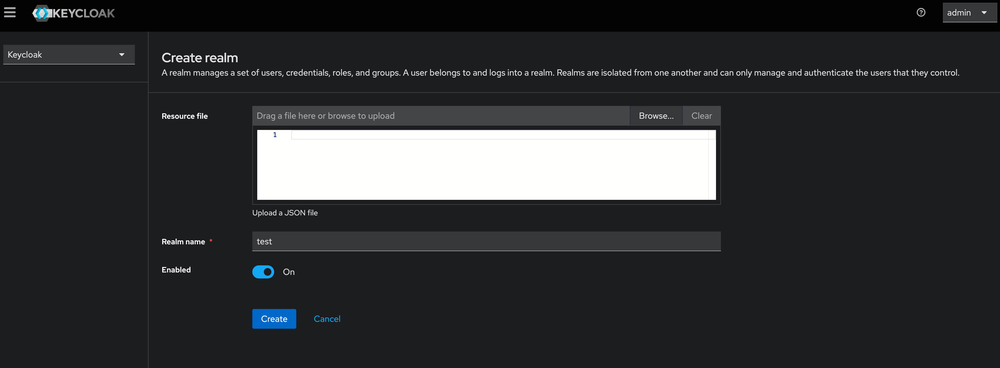
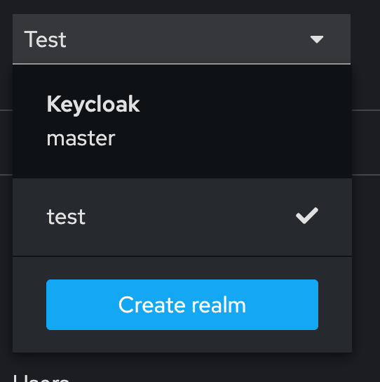
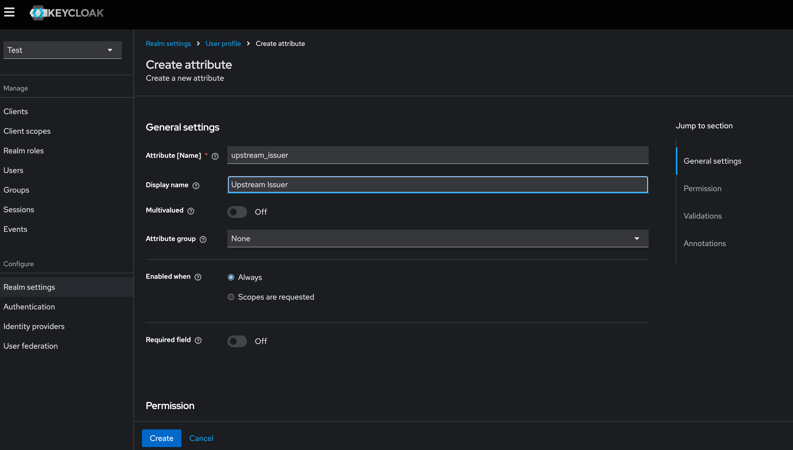
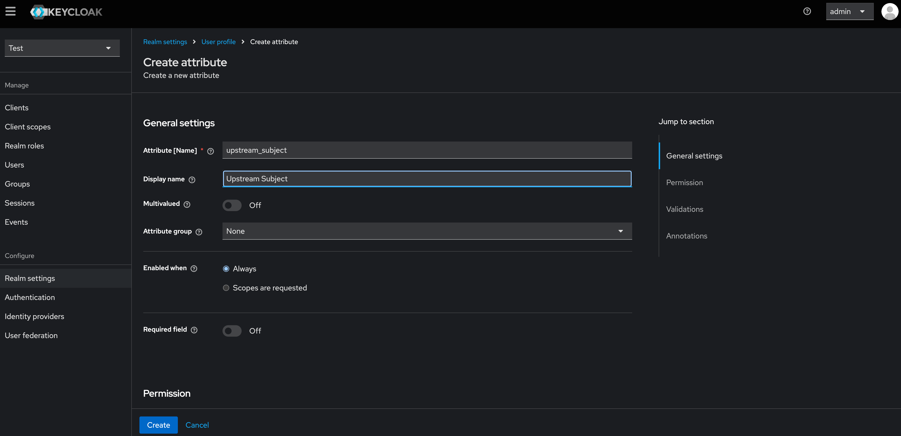
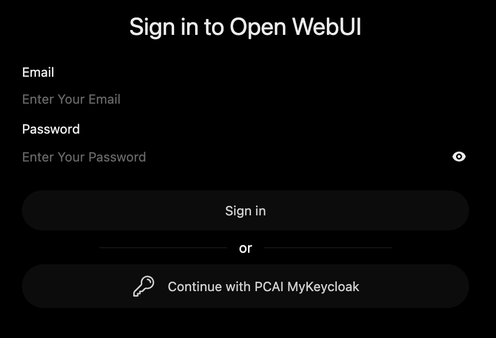

# Federation with the AIE default Keycloak
AIE does not allow any changes to the in-box Keycloak configuration from a product support perspective.
However you may want to use AIE SSO for your own applications or services.
This Keycloak Service Provider Interface (SPI) allows you to connect your Keycloak to the in-box AIE Keycloak without making any changes to the default Keycloak configuration.

## Architecture and flows
```text
+-----------------------------------------+
|                 HPE SSO                 |
+-----------------------------------------+
                    |
                    | OIDC
                    v
+-----------------------------------------+
|         in-box AIE Keycloak             |
|                                         |
|                                         |
|  - User Authentication                  |
|  - ID Token Issuance                    |
+-----------------------------------------+
                    |
                    | OIDC
                    v
+-----------------------------------------+
|          OAuth2 Proxy                   |
|                                         |
|  - SSO Session Management               |
|  - Upstream ID Token Acquisition        |
+-----------------------------------------+
                    |
                    | Upstream ID Token
                    v
+-----------------------------------------+
|          Istio Ingress Gateway          |
|                                         |
|  - AuthorizationPolicy (CUSTOM)         |
|  - External Authentication              |
|  - Authorization Header Injection       |
+-----------------------------------------+
                    |
                    | Authorization: Bearer JWT
                    v
+-----------------------------------------+
|        Downstream YOUR Keycloak         |
|                                         |
|  +-----------------------------------+  |
|  | PCAI Downstream Authenticator SPI |  |
|  |                                   |  |
|  | - JWT Validation                  |  |
|  | - Issuer / Subject Matching       |  |
|  | - Automatic User Registration     |  |
|  | - User Attribute Synchronization  |  |
|  +-----------------------------------+  |
|                                         |
|  +-----------------------------------+  |
|  | Native Keycloak Functions         |  |
|  |                                   |  |
|  | - User Management                 |  |
|  | - Group Management                |  |
|  | - Role Management                 |  |
|  | - OIDC Client Management          |  |
|  | - Downstream Token Issuance       |  |
|  +-----------------------------------+  |
|                                         |
|          PostgreSQL (CNPG)              |
+-----------------------------------------+
                    |
                    | Standard OIDC
                    | ID Token / Access Token
                    | Groups / Roles
                    |
        +-----------+-----------+
        |           |           |
        v           v           v
   +--------+  +---------+  +---------+
   |  App01 |  |   App02 |  |  App03  |
   +--------+  +---------+  +---------+
```


```
Browser
  |
  | 1. Click SSO Login
  v
Application
  |
  | 2. Redirect to Downstream your Keycloak
  v
Istio Ingress Gateway
  |
  | 3. External Auth via AuthorizationPolicy
  v
Existing OAuth2 Proxy
  |
  | 4. Authenticate or Reuse SSO Session
  v
Upstream in-box Keycloak
  |
  | 5. Issue Upstream ID Token
  v
Existing OAuth2 Proxy
  |
  | 6. Return Upstream ID Token
  v
Istio Ingress Gateway
  |
  | 7. Inject Authorization Header
  v
Downstream your Keycloak
  |
  | 8. Execute This Custom Authenticator SPI
  |    - Validate Upstream JWT
  |    - Find or Register User
  |    - Synchronize User Attributes
  |
  | 9. Issue Authorization Code
  v
Browser
  |
  | 10. Redirect to Application Callback
  v
Application
  |
  | 11. Exchange Code for Tokens
  v
Downstream Keycloak
  |
  | 12. Issue Downstream Tokens
  |     with Local Groups and Roles
  v
Application
  |
  | 13. Evaluate Groups and Roles
  v
Login Completed
```

## Setup
First, clone this repository from GitHub.

### Install your Keycloak
Make a configmap which has the SPI jar.
```bash
cd ez-cheat/pcai/keycloak-federation/k8s-manifests
./create_cm.sh -n keycloak
```

Deploy the DB for your Keycloak.

```bash
kubectl apply -f postgresql.yaml
```
While the DB is starting up, replace the AIE domain in [this manifest](./k8s-manifests/keycloak.yaml) with your own.

Once the database is up and running, deploy your Keycloak.

```bash
kubectl apply -f keycloak.yaml
```

### Create your realm
You can now log in to your Keycloak as an **admin** user. The password is stored in the Kubernetes Secret.

```bash
kubectl get -n keycloak secret mykeycloak-initial-admin -o jsonpath={.data.password} |base64 -d
```
Keep this password for the subsequent steps.

The admin console URL is *https://mykeycloak.YOUR_DOMAIN/admin*.

After log in to the GUI, create your realm and select it.





### Add attributes
This SPI requires two attributes.

- upstream_issuer
- upstream_subject
  
Add the these attributes into your realm user profile.





### Create authentication flow
Create an authentication flow using this SPI.

Access to the Keycloak container.

```bash
kubectl -n keycloak exec -it mykeycloak-0 -c keycloak -- bash
```

Log in to Keycloak using the admin password noted in the previous step.

```bash
cd /opt/keycloak/bin

./kcadm.sh config credentials \
  --server http://localhost:8080 \
  --realm master \
  --user admin
```

Set **REALM** to your target realm and **FLOW** to a name of your choice.

```bash
REALM=test
FLOW=pcai-downstream-browser
```

Create an auth flow and configure it.

```bash
./kcadm.sh create authentication/flows \
  -r "$REALM" \
  -s alias="$FLOW" \
  -s providerId=basic-flow \
  -s topLevel=true \
  -s builtIn=false

./kcadm.sh create \
  authentication/flows/"$FLOW"/executions/execution \
  -r "$REALM" \
  -s provider=pcai-downstream-authenticator
```

Get flow ID.

```
./kcadm.sh get \
  authentication/flows/"$FLOW"/executions \
  -r "$REALM"

EXEC_ID=THE_ID_OUTPUT_PREVIOUS_COMMAND
```

Set the SPI execution to required and assign the authentication flow as the realm's default browser flow.

```bash
./kcadm.sh update \
  authentication/flows/"$FLOW"/executions \
  -r "$REALM" \
  -n \
  -s id="$EXEC_ID" \
  -s requirement=REQUIRED

./kcadm.sh update realms/"$REALM" \
  -s browserFlow="$FLOW"

```

### Register a user
This SPI automatically registers users when they access to your Keycloak for the first time. Therefore each user must access to your Keycloak below at least once. 

**https://mykeycloak.YOUR_AIE_DOMAIN/realms/YOUR_REALM/account**.

After the initial access, you should see the same user information as in the in-box Keycloak. You can then add the user to groups, assign custom attributes, and configure access to your applications in your Keycloak.

